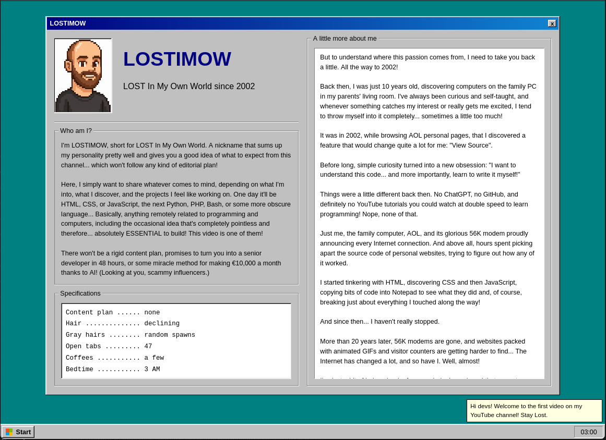

# Windows 98, Built with an Empty HTML Body

Can you build an entire website without writing a single element inside the HTML body?

This project explores that question by recreating a Windows 98-inspired desktop interface using CSS and a standard HTML5 document with a completely empty `<body>`.
Instead of relying on conventional HTML markup, the interface uses CSS-generated content, pseudo-elements, and unconventional selectors to turn elements that are normally invisible into part of the visual presentation.
The result is an experimental desktop-style interface featuring classic Windows 98 design elements, built without JavaScript, frameworks, or additional HTML elements inside the body.

## Technical Approach

The project combines several CSS techniques:
- **CSS-generated content:** Using the `content` property to display text and interface details without conventional body markup.
- **Pseudo-elements:** Building visual components with `::before` and `::after`.
- **Unconventional element styling:** Repurposing normally hidden HTML elements as part of the rendered interface.
- **CSS custom properties:** Managing colors, dimensions, and shared design values.
- **CSS Grid and Flexbox:** Organizing the desktop layout and its interface components.
- **Attribute selectors:** Targeting existing HTML elements and their attributes.
- **Classic Windows styling:** Recreating beveled borders, raised and recessed surfaces, gradients, and the recognizable Windows 98 aesthetic.
- **Responsive CSS:** Adapting the layout to different viewport sizes.

## Project Constraints

The implementation follows three main rules:
1. The HTML `<body>` must remain completely empty.
2. No JavaScript is allowed.
3. No frameworks or external UI libraries are used.

All visible interface components must be created or styled through CSS, using the elements already available in the HTML document.

## Why Build This?

This is a CSS experiment and not a recommended approach to building production websites. It deliberately challenges conventional document structure to explore how far CSS can go when the usual HTML elements are unavailable.
The project also demonstrates the difference between visual presentation and semantic document structure. CSS can generate a surprisingly convincing interface but it cannot replace proper HTML semantics, accessible controls or application behavior.

The goal is to experiment with the browser's rendering capabilities while recreating a small piece of web and computing nostalgia.

## ASMR Programming

This project was created for the first video on my YouTube channel LOSTIMOW. You can see the full video here : https://www.youtube.com/watch?v=q_zefPj8v9k
The recording follows the coding process without spoken commentary, focusing on the source code and the gradual construction of the interface.

## License

This project is licensed under the MIT License.
See the [LICENSE](LICENSE) file for details.

---

**No Talking. No Vibe Coding. Just Code.**

Stay Lost.
